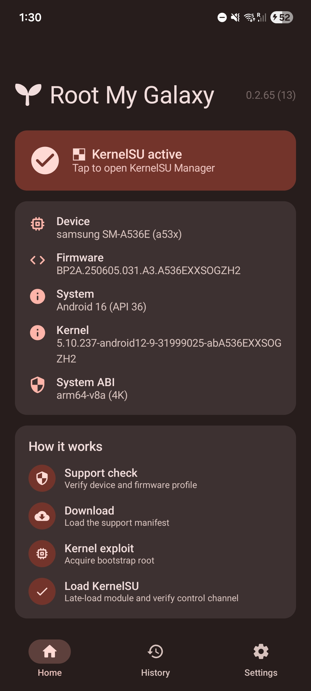
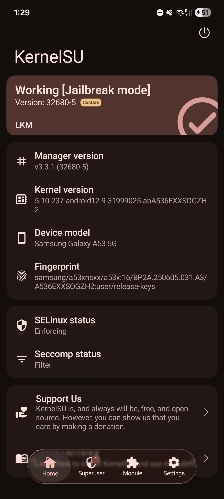

# SM-A536E A536EXXSNGZG3 validation

This profile was validated on a Galaxy A53 5G running the exact firmware and
kernel below.

| Field | Value |
| --- | --- |
| Model | `SM-A536E` |
| Device | `a53x` |
| Firmware | `A536EXXSNGZG3` |
| Android | 16 / API 36 |
| Page size | 4096 |
| Kernel | `5.10.237-android12-9-31999025-abA536EXXSNGZG3` |

The payload ran from the normal application domain
(`u:r:untrusted_app:s0`), found the KASLR slide with the CPU0-pinned prefetch
channel, found and reclaimed the target page with KernelSnitch, established
kernel read/write, and reached `ROOT_OK`. The runtime path uses neither
tracefs nor `perf_event_open`.

The exact KernelSU module was late-loaded on the same boot. KernelSU Manager
reported `Working <LKM> [Jailbreak mode]`, version `32525-2`. That was KernelSU
v3.2.5. The v3.3.0 rebuild (`KSU_VERSION` 32601, commit
`932014ab5b2c9b74a3d11e2ec4d17dd10fc9442e`) used the same Samsung KDP/RKP/DEFEX
and no-patch-text source, loaded on the same hardware, and made KernelSU Manager
report version `32601-2` with no driver/manager mismatch. The published
artifacts are now the v3.3.1 rebuild (`KSU_VERSION` 32680, commit
`0c0fdb960178fa12d80d6cbcfdcb6ad8be6a865d`), which is build- and
statically verified but not yet loaded on hardware.

The production source is split by stage under
`src/targets/a53x-A536EXXSNGZG3/`: `payload.c` is the app entry point,
`ghostlock.c` provides the prefetch slide leak and 64-bit write,
`page.c` performs KernelSnitch discovery and deterministic SLUB/SKB reclaim,
and `chain.c` validates ARW, restores modified state, and starts the root
helper. It uses the repository's shared `src/kernelsnitch` code. Calibration,
perf, tracefs, oracle, and dry-run modes are not part of this payload.

The reclaim fix does not depend on the allocator's ambient partial-slab count.
After selecting a complete Normal-zone `mm_struct` slab, the payload allocates
24 slab-sized trigger batches (816 references) and a final rotation object on
CPU0. It frees one object from each trigger batch, keeps the other trigger
references alive, and frees the selected slab's last object only after that
drain pressure exists. The holder process keeps those references until ARW is
established, then normal process teardown releases them. DMA32 candidates are
skipped because they did not reclaim reliably into the SKB allocation path on
this device.

## Device evidence

| Root My Galaxy | KernelSU Manager |
| --- | --- |
|  |  |

## Published artifacts

| Artifact | Bytes | SHA-256 |
| --- | ---: | --- |
| `artifacts/a53x-A536EXXSNGZG3/cve-2026-43499-app.so` | 104128 | `fb9b2e08adb8046f3ae0566cc0b10ae55c5bb72b0d04396a935141e242060fdf` |
| `kernelsu/android12-5.10_kernelsu-A536EXXSNGZG3-kdp.ko` | 376368 | `364b506758367f40d945fcc042a96fad9d503987eccb31782b2ad76b4ead57ca` |
| `kernelsu/ksud-A536EXXSNGZG3-kdp` | 5144920 | `4df3985ba7a6ea349442e874346b9eda4924997ce5f3287355c1badd402f2f97` |

The current KernelSU pair is the v3.3.1 build (`32680`). It was produced with
`kernelsu/tools/build-a53x-kernelsu.sh`: the module from the DDK image
`ghcr.io/ylarod/ddk-min:android12-5.10-20260313` (Android clang
`r416183b`, thin LTO, `CONFIG_CFI_CLANG=y`, `CONFIG_MODVERSIONS=y`, empty
`Module.symvers`), and `ksud` with rustc 1.99.1 and NDK r29
(`14206865`, API 26 linker). `KSU_VERSION` resolved to `32680` from the tagged
checkout.

The module carries exact vermagic, a zero-length `__versions` section, and
`scmversion: g0c0fdb960178-dirty`:

```text
5.10.237-android12-9-31999025-abA536EXXSNGZG3 SMP preempt mod_unload modversions aarch64
```

The embedded module inside `ksud` was verified byte-for-byte: a raw-deflate
asset at `0x3111e` inflates to 376368 bytes with the module's SHA-256.
`ksud` is an aarch64 PIE for Android 26 and reports `3.3.1 (uapi: 5)` /
`32680`.

The superseded v3.3.0 pair (device-tested, Manager `32601-2`) was
`347432 / c8a8ceb752c4b17140a1da3825549eb481d67e94f1283fd7a2f8ca24bcce77a4`
for the module and
`5090760 / 10c395d7358e832d971ae93ec1adf6930ef41f5374ea3df0ea2b992b8c5aba0c`
for `ksud`; its embedded asset inflated to 347432 bytes. The superseded v3.2.5
pair (the device-tested one) was
`341368 / ae9d3815c69d708063a77c49470357f2b5b45ba7313cde6cebbf32ae05fa17a8`
for the module and
`4870752 / c35130bf54f7b8e3c31eee2349c7e053d1e2878b4d47b21090012523ff02e3ef`
for `ksud`. The v3.3.0 module's audit against the target `vmlinux` resolved all
168 undefined imports; the only difference from the v3.2.5 module was the
intended `tracepoint_probe_register` -> `tracepoint_probe_register_prio`
change.

What still has to happen for the v3.3.1 pair: load it on hardware and confirm
KernelSU Manager reports `Working <LKM> [Jailbreak mode]` with version
`32680-2` and no `Kernel update required` banner.

The result is a volatile LKM installation. A reboot removes KernelSU and the
bootstrap/late-load process must be run again. No boot image was flashed.

## KernelSU v3.3.1 rebuild (32680)

KernelSU Manager 3.3.1 is version code `32680`. A Manager newer than the loaded
driver shows `Kernel update required` in the Manager home screen while the LKM
itself keeps working, which is what a 3.3.1 Manager reports against the
`32601-2` driver from the previous pair. Clearing it needs a driver and `ksud`
built from the v3.3.1 tree, not a Manager change.

The build is reproducible from this repository:

- `kernelsu/patches/KernelSU-v3.3.1-samsung-kdp-rkp-defex.patch` applies cleanly
  to the tagged v3.3.1 commit `0c0fdb960178fa12d80d6cbcfdcb6ad8be6a865d` and
  carries the same Samsung KDP/RKP/DEFEX, no-patch-text, staging, and
  `KSU_VERSION` changes as the v3.3.0 patch, with the Kbuild fallback moved to
  `32680`;
- `kernelsu/tools/build-a53x-kernelsu.sh` runs both build phases with the same
  options that produced the v3.3.0 pair (thin LTO, exact GZG3 release, empty
  `Module.symvers`, `CONFIG_KSU_SAMSUNG_NO_PATCH_TEXT=y`). It was run on WSL2
  (Arch Linux, kernel 6.18 WSL2, 4 cores) with podman for the DDK image and
  rustc 1.99.1 plus NDK r29 for `ksud`.

The import audit was re-run rather than copied. v3.3.1 rewrote
`kernel/feature/selinux_hide.c`, which now carries local copies of the SELinux
decision helpers instead of importing the in-kernel ones. Measured with
`llvm-nm -u` on the stripped modules, the undefined import set moves from 202
names to 221:

- dropped: `security_compute_av_user`, `security_context_str_to_sid`,
  `security_context_to_sid`, `security_sid_to_context`, `full_name_hash`,
  `__close_fd`;
- added: `sidtab_search_entry`, `sidtab_sid2str_get`, `sidtab_sid2str_put`,
  `sidtab_context_to_sid`, `ebitmap_cmp`, `ebitmap_contains`, `ebitmap_destroy`,
  `cond_compute_av`, `policydb_context_isvalid`, `mls_context_to_sid`,
  `mls_sid_to_context`, `mls_compute_context_len`, `security_bounded_transition`,
  `current_is_single_threaded`, `__arm64_sys_close`, `___ratelimit`,
  `kick_all_cpus_sync`, `kasprintf`, `kmemdup_nul`, `kstrtoull`, `find_next_bit`,
  `sprintf`, `strchrnul`, `strcpy`, `strrchr`.

KernelSU's `check_symbol` resolved every one of them against the DDK
`android12-5.10` `vmlinux` with a zero-length `__versions` section. The stricter
audit against the recovered `A536EXXSNGZG3` `vmlinux` with
`kernelsu/tools/audit_module_against_target.py` has not been run for this pair,
because that ELF is not part of this repository.

The new `selinux_hide` code also reaches `prepare_creds()`/`commit_creds()` in
`selinux_setprocattr_hook`. That hook can only be installed through
`ksu_patch_text()`, which the `CONFIG_KSU_SAMSUNG_NO_PATCH_TEXT` build refuses,
so the new credential path stays unreachable on this target, exactly as in the
device-tested v3.3.0 module.

Firmware coverage is unchanged by the version bump. The exact GZG3 vermagic is
not what restricts this pair to GZG3: `ksuinit::load_module()` reads the
vermagic the kernel reports when `init_module` fails, rewrites the module's
`.modinfo` entry with it, and retries, so this module also loads on
`5.10.237-android12-9-31999025-abA536EXXSOGZH2` (`A536EXXSOGZH2`) kernels.

This profile is exact-build support; it does not claim compatibility with
other Galaxy A53 models, firmware, or kernel releases.
